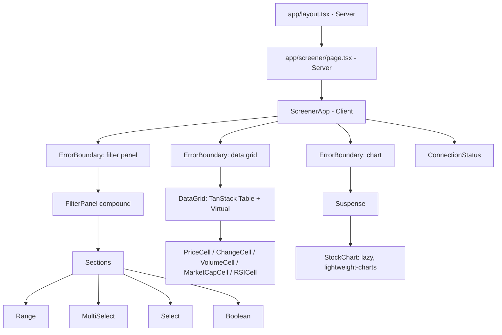
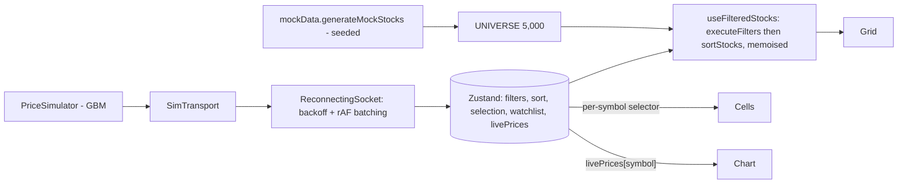

# Architecture

## Component hierarchy

## State and data flow

Static fundamentals are filtered once per filter change. Live prices never re-run the filter pipeline; each price cell subscribes to its own symbol, so a tick re-renders one cell.

## Filter pipeline (lib/filterEngine.ts)
Parse (config list to AND/OR AST) -> Optimise (order by sampled pass-rate) -> Execute (short-circuit) -> Sort (stable, nulls last).

## Decision log
| Choice | Why |
|---|---|
| Zustand without immer | Prices are held in a plain record and replaced once per batch; immer adds proxy cost on the hottest path. |
| livePrices separate from the stock array | Avoids copying and re-filtering 5,000 rows on every tick. |
| Per-cell store selectors | Only the changed cell re-renders (brief task 5.3). |
| Pure indicator functions on number[] | Testable with the brief's verification data, independent of the UI. |
| Injected timers/scheduler in ReconnectingSocket | Backoff and batching are testable without fake-timer libraries. |
| lazy() + Suspense for the chart | Keeps lightweight-charts out of the initial bundle. |
